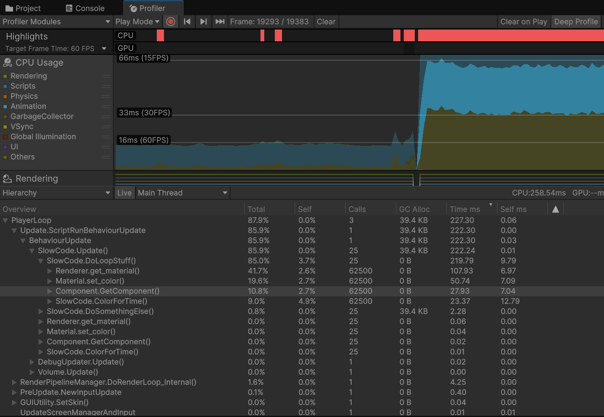
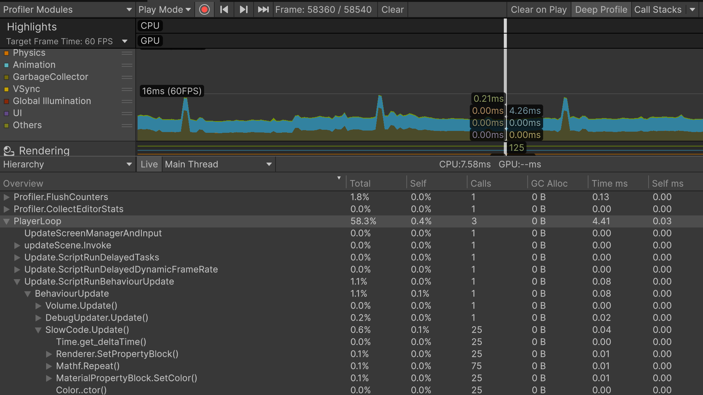

# M2 DV2: Profiling  
Play Here:  
https://samuel5024.github.io/M2-DV2-Profiling/  

---  

*Changes I made:*  
- Removed DoLoopStuff() and DoOtherStuff() methods
- Got rid of Debug Statements
- Used Renderer & MaterialPropertyBlock to avoid frequent calls 
- Used ID instead of shader property to set the color
- Stored shader properties inside MaterialPropertyBlocks
- Used SetPropertyBlock to apply the new color

---  
Before Profiling:  

  

---  
After Profiling:  

